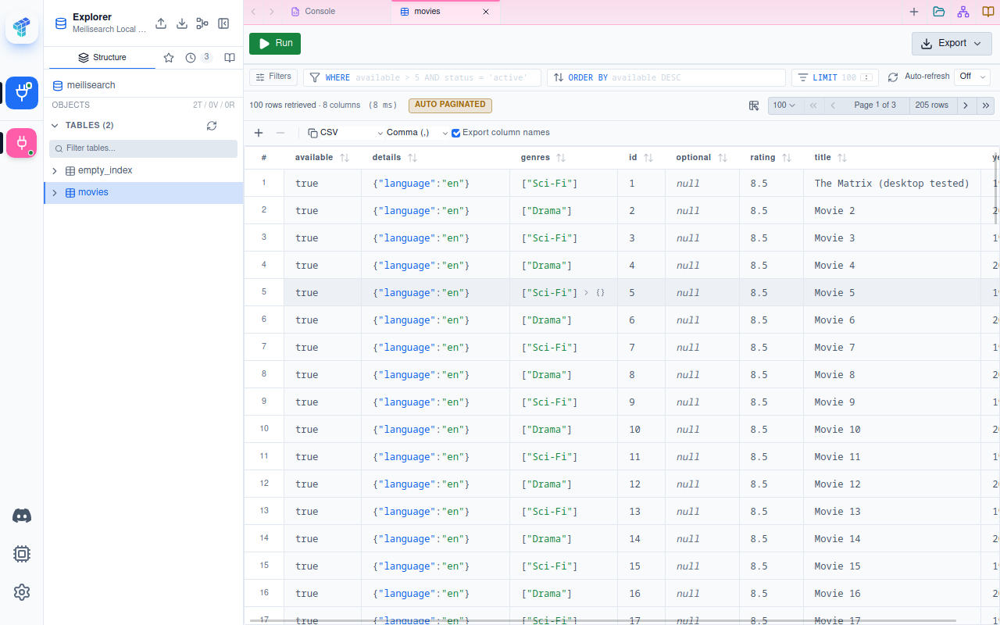
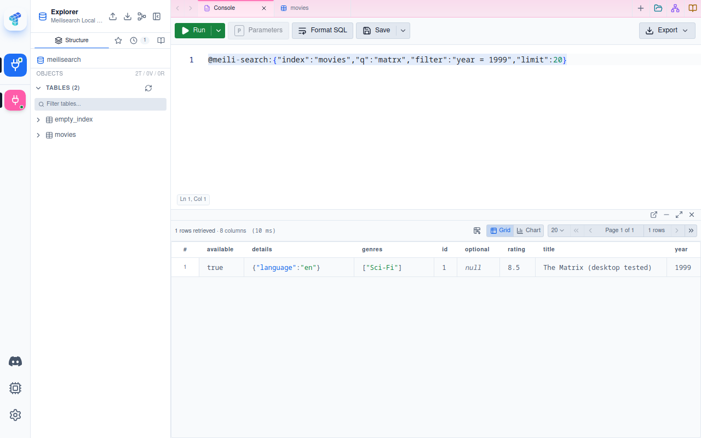

# Meilisearch for Tabularis

A native JSON-RPC driver for Meilisearch: browse indexes as tables, infer columns,
edit documents and run typo-tolerant searches in the ordinary Tabularis editor.

## Install and connect

Install the archive from [Releases](https://github.com/NewtTheWolf/meilisearch-tabularis/releases)
through Tabularis's plugin installer. This release targets Tabularis **0.32.0+**.
Packages are provided for Windows x64, macOS Intel and Apple Silicon, and Linux
x64/ARM64. Each archive is verified on its matching native runner before publication.
Linux x64 requires glibc 2.34+. Desktop GUI E2E coverage is currently Linux x64 only.

Choose **Add Connection > Meilisearch**. Enter the host and port (default `7700`)
and your API key in the password field. Leave the key empty only for an unsecured
local development instance. The connection test checks a protected endpoint as
well as health, so an invalid key fails before connecting.

Enable TLS for remote HTTPS services. TLS certificates use the system trust store;
custom CA files and client certificates are not implemented by this driver.

## Browse and search

Double-click an index in the Explorer to browse its documents. Host pagination
uses `limit` and `page`, with at most 1,000 documents per request. Columns come
from a bounded sample; nested objects and arrays remain JSON values. An empty
index with an explicit primary key still exposes that key.

The grid's simple `SELECT * FROM "movies"` browse query is supported. Meilisearch
is not a SQL database: SQL filters, sorting, joins, DDL and SQL import/export are
not supported. Unsupported SQL returns an error instead of silently ignoring clauses.
Use a native search request in the normal query editor:

```text
@meili-search:{"index":"movies","q":"matrx","limit":20}
```

For native filters and sorting, configure the corresponding Meilisearch index
attributes first, then use:

```text
@meili-search:{"index":"movies","q":"","filter":"year = 2024","sort":["year:desc"],"limit":20,"offset":0}
```

Additional native search options are forwarded to Meilisearch for validation.
The result grid displays hits, not the API's separate facet distribution or timing
metadata. Search totals are Meilisearch estimates and respect its configured
maximum searchable result window. Browse ordering follows Meilisearch document order.

The old optional toolbar source under `ui/` is not shipped. Its SQL-only
`usePluginQuery` route cannot execute native Meilisearch requests in the current
Tabularis sandbox. No sandbox restrictions are bypassed; native queries use the
normal editor and the executable driver's protocol.

## Document writes

Insert, single-cell update and delete use Tabularis's `pk_map` contract and wait
for the asynchronous Meilisearch task to succeed. Task failure is returned as an
error. If a task times out, inspect its status before retrying: the write may still
complete later. Your API key needs document read/write, index read and task read
permissions for these operations.

Create indexes with an explicit primary key before inserting. Primary-key edits,
composite keys and updates/deletes without a key are rejected. Updates preserve
unmodified fields. Insert checks for an existing document before submitting a
replacement operation; Meilisearch does not provide atomic SQL INSERT semantics,
so concurrent external writers can still race that check. There are no SQL transactions.

The schema inference sample size is configurable (default 20, maximum 1,000).
Index discovery currently lists the first 1,000 indexes. Schema overrides, index
creation/deletion, index settings administration and vector-specific UI are not
implemented or advertised by this release.

## Local verification

```sh
docker run --rm --name tabularis-meili-e2e -p 127.0.0.1:17700:7700 \
  -e MEILI_MASTER_KEY=tabularis-meili-local-demo-key \
  -e MEILI_NO_ANALYTICS=true getmeili/meilisearch:v1.56.2
# In another terminal:
cargo test --locked
cargo clippy --all-targets -- -D warnings
cargo build --release --locked
python3 tests/seed.py
python3 tests/live.py
```

The seed script resets only `movies` and `empty_index` on the configured test
instance and loads 205 synthetic movie documents. Never point it at production.
Override `MEILI_TEST_URL` and `MEILI_TEST_KEY` for a dedicated test service.
`MEILI_TEST_BINARY` selects an extracted release binary for archive verification.

See [TESTING.md](TESTING.md) for the native desktop and release verification record.

## Screenshots

Actual Tabularis desktop captures with local synthetic data, no production credentials.




## License

Apache-2.0. See [LICENSE](LICENSE).
